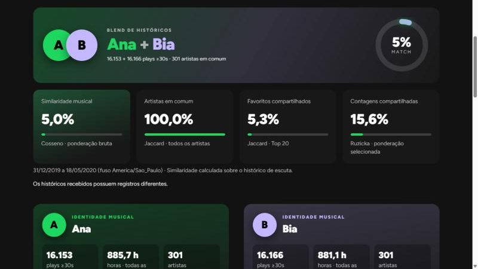
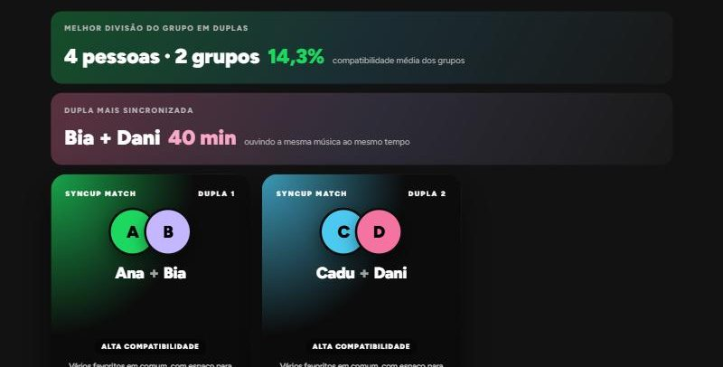
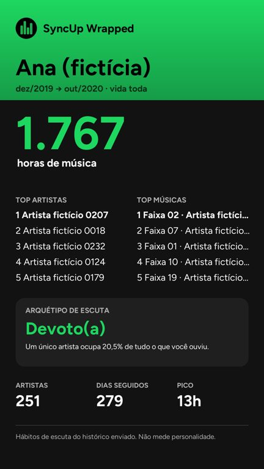

# SyncUp v1.4

Compare o seu histórico do Spotify com o dos amigos e descubra com quem você está em sintonia. Tudo roda **no seu computador**: sem conta, sem servidor e sem anúncios. Projeto de ciência de dados, **código aberto** ([licença MIT](LICENSE)).

[](https://github.com/Hazykiuu/SyncUp/actions/workflows/testes.yml)
[](https://github.com/Hazykiuu/SyncUp/actions/workflows/lint.yml)
[](https://github.com/Hazykiuu/SyncUp/releases/latest)
[](LICENSE)


**Site:** <https://hazykiuu.github.io/SyncUp/>


> **Aviso:** as métricas descrevem o recorte de escuta enviado. Elas não medem personalidade nem afinidade amorosa.

## Como rodar o SyncUp na sua máquina

### 1. Instale o Python (uma vez)

Baixe o Python 3.10 ou mais novo em <https://www.python.org/downloads/> e instale. **No Windows, marque a caixa "Add python.exe to PATH"** na primeira tela do instalador.

### 2. Baixe o SyncUp

No topo desta página, clique em **Code → Download ZIP** e extraia o arquivo numa pasta, por exemplo `Documentos\SyncUp`. Quem usa git pode clonar:

```bash
git clone https://github.com/Hazykiuu/SyncUp.git
```

### 3. Abra o SyncUp

**Windows:** dê dois cliques em **`iniciar.bat`**, dentro da pasta do SyncUp.

- Na primeira vez, ele cria um ambiente próprio e instala tudo. Leva alguns minutos e precisa de internet.
- Nas próximas vezes, abre em poucos segundos.
- O navegador abre sozinho em <http://127.0.0.1:7860>. Se não abrir, copie esse endereço no navegador.

**Mac ou Linux:** abra o terminal na pasta do SyncUp e rode:

```bash
python3 -m venv .venv
.venv/bin/python -m pip install -r requirements.txt
.venv/bin/python app.py
```

Nas próximas vezes, basta o último comando.

### 4. Peça o seu histórico ao Spotify

No Spotify, entre em **Conta → Privacidade → Baixar seus dados** e marque **Histórico estendido de streaming**. O Spotify manda um ZIP por e-mail, em geral em alguns dias. Esse ZIP é o que você envia no SyncUp. Não precisa extrair.

Enquanto o histórico não chega, use o botão **"Testar com dados fictícios"** da aba Wrapped ou os ZIPs de exemplo da pasta `exemplos_ficticios/`.

### 5. Para fechar

Feche a janela preta (o terminal) que o `iniciar.bat` abriu, ou aperte `Ctrl+C` nela.

### Se algo der errado

| Problema | O que fazer |
|---|---|
| "Não achei o Python 3.10 ou mais novo" | Instale o Python pelo site e marque **"Add python.exe to PATH"**. Depois, abra o `iniciar.bat` de novo. |
| O Windows abre a Microsoft Store ao chamar o Python | É um atalho do Windows, não o Python de verdade. Instale pelo python.org. O `iniciar.bat` procura primeiro o `py`, que vem com ele. |
| "Address already in use" ou porta 7860 ocupada | O SyncUp já está aberto em outra janela. Feche a outra ou use <http://127.0.0.1:7860>. |
| A instalação falhou no meio | Confira a internet, apague a pasta `.venv` e abra o `iniciar.bat` de novo. |

## O que dá para fazer

### Dupla: duas pessoas lado a lado

Envie o histórico de duas pessoas e veja o Blend, a identidade musical de cada um, os rankings, os gráficos e **Em sintonia**: os momentos em que vocês ouviram a mesma música ao mesmo tempo. Dá para baixar um story PNG e uma playlist em CSV.



### Match: quem combina com quem

Junte a galera por qualquer fonte. O SyncUp compara todos com todos, forma as duplas que mais combinam (com número ímpar, uma vira trio), mostra a **dupla mais sincronizada** e gera pôsteres e uma playlist da festa.



Fontes aceitas, que podem ser misturadas:

- **Histórico ZIP:** sem limite de pessoas.
- **ListenBrainz:** só o nome de usuário. A pessoa conecta o Spotify uma vez em [listenbrainz.org](https://listenbrainz.org).
- **Convite por código:** o amigo gera um código no SyncUp dele (aba Match → "Criar o meu convite") e manda por mensagem. Só os rankings viajam.
- **Login com Spotify:** até 5 pessoas, cadastradas pelo dono do app (veja "Configurar o login do Spotify", abaixo).

### Wrapped: a sua vida toda no Spotify

Envie o seu histórico completo e veja, em stories, o artista e a música da vida, os anos, os recordes, o relógio musical e o seu arquétipo de escuta. Baixe o story em PNG 1080×1920 para postar.



### Grupo: de 3 a 6 pessoas

Um arquivo por pessoa. Mostra uma matriz de compatibilidade de todos com todos, os perfis e os arquétipos. As regras técnicas ficam em "Detalhes técnicos".

### Configurar o login do Spotify (opcional, só para quem criou o app)

O Spotify só libera o login, em apps pessoais, para **no máximo 5 contas cadastradas**, e o dono do app precisa de Premium. Por isso o ZIP, o ListenBrainz e o convite continuam sendo os caminhos sem limite.

1. Em <https://developer.spotify.com/dashboard>, crie um app e marque **Web API**.
2. Em **Redirect URIs**, cadastre exatamente `http://127.0.0.1:7860/spotify/callback`.
3. Em **User Management**, adicione o nome e o e-mail do Spotify de cada amigo (até 5).
4. Copie o **Client ID** e cole na aba Match, em "Configurar". Também dá para definir a variável `SPOTIFY_CLIENT_ID`. O secret não é necessário: o login usa PKCE.

## Privacidade

- **Fica no computador:** os históricos enviados (apagados em até 1 hora), os perfis do Spotify (só rankings) e o cache. Para ver e apagar, abra *Opções de dados → Meus dados*.
- **Vai para a internet só se você pedir:** o Spotify (ao conectar a conta), o ListenBrainz (o nome de usuário digitado) e o MusicBrainz (nomes de artistas, só com a caixa de estilo marcada).
- **App no navegador, Wrapped com "Começar com capas e som" (opcional):** só depois do toque, o SyncUp envia os códigos das suas músicas mais ouvidas para o Spotify (capas e fotos), o nome dos seus artistas para o MusicBrainz e os nomes das músicas para a Apple/iTunes (trechos de 30 s), além do seu endereço IP. O histórico e o seu nome não saem do aparelho. O navegador guarda só os endereços das capas, por até 30 dias; o botão "Apagar capas guardadas" limpa na hora.
- **Nunca é guardado:** o token do Spotify, o IP e o modelo do aparelho.

**Créditos:** capas e fotos de artistas vêm do Spotify; o logo do Spotify é marca da Spotify AB, usado conforme as [diretrizes de design](https://developer.spotify.com/documentation/design) e fora da licença MIT. Trechos de áudio: iTunes (Apple). Dados de artistas: MusicBrainz.

## Limitações

- Rankings e traços usam plays de 30 s ou mais. Horas incluem todas as execuções válidas.
- Arquétipos são regras simples e visíveis na tela (por exemplo, top 2 artistas com 60% ou mais dos plays). Amostras pequenas podem distorcer.
- Coincidências no tempo não provam influência. Nomes de artistas iguais escritos de jeitos diferentes não são unidos automaticamente.
- A similaridade não é uma recomendação validada com usuários reais.

## Para desenvolvedores

```bash
python -m pip install -r requirements-dev.txt
python -m pytest -q
python -m ruff check .
python -m ruff format --check .
```

O CI roda os mesmos comandos no GitHub, em Python 3.10 e 3.12. O cache Parquet é opcional: `python -m pip install -r requirements-parquet.txt`.

| Módulo | Papel |
|---|---|
| `dados.py`, `configuracao.py` | Leitura de ZIP/JSON, validação, fuso, cache por SHA-256 |
| `metricas.py`, `perfis.py`, `analise.py` | Cosseno, Jaccard, diversidade, arquétipos, Dupla e Grupo |
| `recursos.py` | Sintonia, momentos sincronizados e Ponte Musical |
| `perfil_gosto.py`, `conciliacao.py`, `convite.py` | Perfil unificado, Match (emparelhamento ótimo) e convite por código |
| `spotify_api.py`, `listenbrainz.py`, `generos.py` | Login PKCE, ListenBrainz e MusicBrainz |
| `wrapped.py`, `arquetipos.py`, `stories.py`, `cartao.py` | Wrapped, stories e PNGs |
| `festa.py`, `exportacoes.py`, `privacidade.py` | Playlist da festa, CSV protegido e "Meus dados" |
| `ui/`, `componentes.py`, `syncup.js`, `styles.css` | Interface Gradio 6 no tema Spotify |

```python
from app import ConfiguracaoCarga, comparar

r = comparar('a.zip', 'b.zip', 'Pessoa A', 'Pessoa B',
             configuracao=ConfiguracaoCarga(musicas_ignoradas=()))
print(r.metricas.cosseno)
```

**Benchmark:** `python tools/gerar_dados_falsos.py a.zip --seed 41` gera um histórico fictício de ~300 mil eventos, e `python medir_desempenho.py a.zip b.zip --repeticoes 3 --somente-nucleo --saida benchmark/meu_pc` mede os tempos.

**Dependências**, todas abertas (`tests/test_licencas.py` confere): Gradio e orjson (Apache-2.0), FastAPI e Plotly (MIT), httpx e pandas (BSD-3-Clause), Pillow (MIT-CMU), pytest e Ruff (MIT) e a fonte Figtree (SIL OFL 1.1). O site (`site/`) usa a Lenis (MIT), com o visual adaptado do modelo Lumora do GetLayers.

**Contribuir:** abra uma *issue* ou um *pull request*. Nunca envie históricos reais nem a pasta `perfis_spotify/`: são dados pessoais. O histórico de cada versão está no [CHANGELOG](CHANGELOG.md).

## Rumo à 2.0

Uma ideia para o futuro é **descobrir pessoas com gosto parecido** e conversar com elas no app. Isso exigiria um servidor com consentimento explícito e cuidado com a LGPD, descoberta só por perfil resumido, moderação e, para o chat, um protocolo aberto como o [Matrix](https://matrix.org).

## Créditos

Feito por Carlos: [GitHub](https://github.com/Hazykiuu/SyncUp) · [X @HazyKiuu](https://x.com/HazyKiuu). Licença [MIT](LICENSE).
