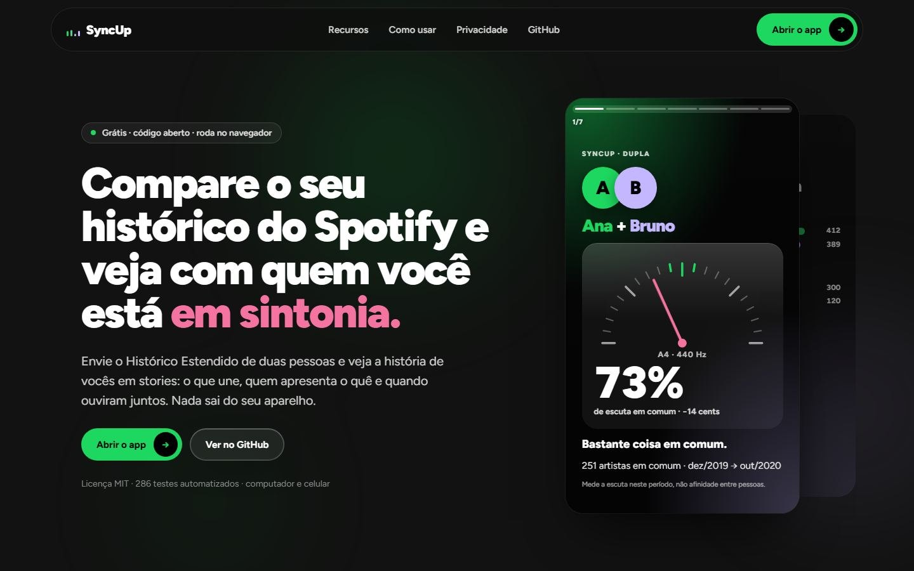
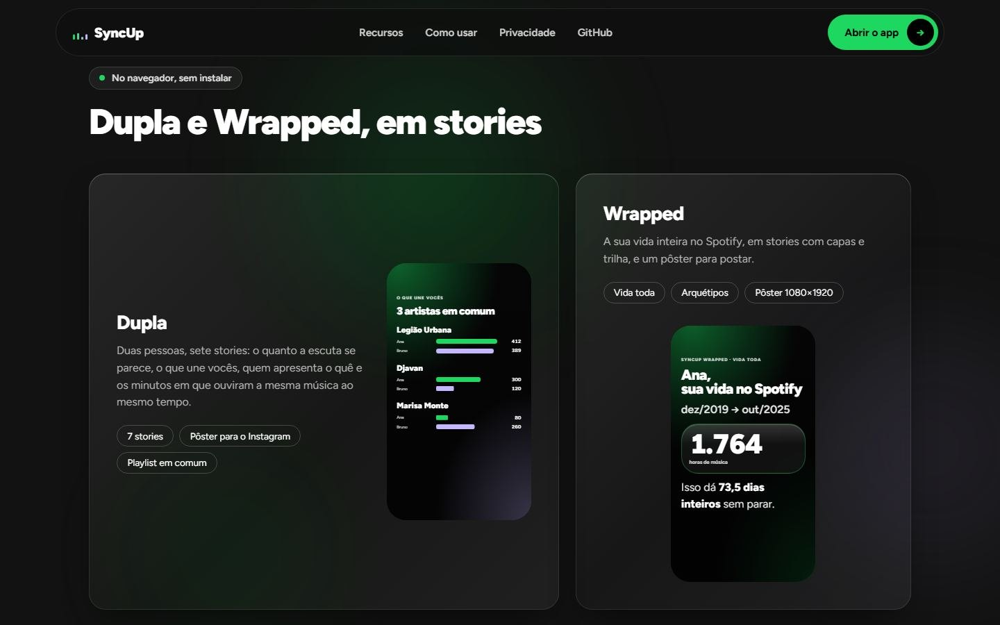
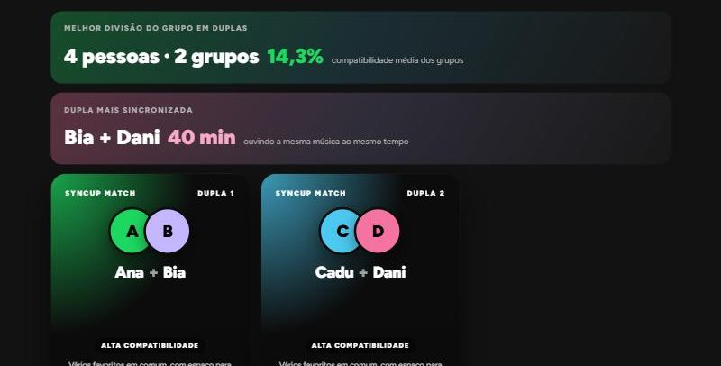

# SyncUp v1.28

Compare o seu histórico do Spotify com o dos amigos e veja com quem você está em sintonia, em stories. **Use direto no navegador**, no computador ou no celular: sem instalar, sem conta, sem anúncios, e o histórico não sai do seu aparelho. Há também um app para PC com o Grupo e as fontes extras do Match (ListenBrainz e gêneros). Projeto de ciência de dados, **código aberto** ([licença MIT](LICENSE)).

[](https://github.com/Hazykiuu/SyncUp/actions/workflows/testes.yml)
[](https://github.com/Hazykiuu/SyncUp/actions/workflows/lint.yml)
[](https://github.com/Hazykiuu/SyncUp/releases/latest)
[](LICENSE)


**Site:** <https://hazykiuu.github.io/SyncUp/> · **App no navegador:** <https://hazykiuu.github.io/SyncUp/app/>



> **Aviso:** as métricas descrevem o recorte de escuta enviado. Elas não medem personalidade nem afinidade amorosa.

## Usar no navegador

1. Peça o seu histórico ao Spotify (veja o passo 4, abaixo).
2. Abra <https://hazykiuu.github.io/SyncUp/app/> no computador ou no celular.
3. Envie o ZIP: na **Dupla**, o de duas pessoas; no **Wrapped**, o seu; na **Batalha**, o de 3 a 6 pessoas. Não precisa extrair.

Sem histórico ainda? Use **"Ver um exemplo"**. O Grupo (matriz de compatibilidade), por enquanto, só existe no app para PC.

## Como rodar o SyncUp na sua máquina

### 1. Instale o Python (uma vez)

Baixe o Python 3.10 ou mais novo em <https://www.python.org/downloads/> e instale. **No Windows, marque a caixa "Add python.exe to PATH"** na primeira tela do instalador.

### 2. Baixe o SyncUp

No topo desta página, clique em **Code → Download ZIP** e extraia o arquivo numa pasta, por exemplo `Documentos\SyncUp`. Quem usa git pode clonar:

```bash
git clone https://github.com/Hazykiuu/SyncUp.git
```

### 3. Abra o SyncUp

**Windows:** dê dois cliques em **`iniciar.bat`**, dentro da pasta do SyncUp.

- Na primeira vez, ele cria um ambiente próprio e instala tudo. Leva alguns minutos e precisa de internet.
- Nas próximas vezes, abre em poucos segundos.
- O navegador abre sozinho em <http://127.0.0.1:7860>. Se não abrir, copie esse endereço no navegador.

**Mac ou Linux:** abra o terminal na pasta do SyncUp e rode:

```bash
python3 -m venv .venv
.venv/bin/python -m pip install -r requirements.txt
.venv/bin/python app.py
```

Nas próximas vezes, basta o último comando.

### 4. Peça o seu histórico ao Spotify

No Spotify, abra [spotify.com/account/privacy](https://www.spotify.com/account/privacy/) no navegador (no celular também, mas não pelo app do Spotify), vá em **Baixe seus dados** e marque só o **Histórico ampliado de streams**. O Spotify manda um ZIP por e-mail, em geral em menos de 1 dia. Esse ZIP é o que você envia no SyncUp. Não precisa extrair.

Enquanto o histórico não chega, use o botão **"Ver um exemplo"** do app web ("Testar com dados fictícios" no app para PC) ou os ZIPs de exemplo da pasta `exemplos_ficticios/`.

### 5. Para fechar

Feche a janela preta (o terminal) que o `iniciar.bat` abriu, ou aperte `Ctrl+C` nela.

### Se algo der errado

| Problema | O que fazer |
|---|---|
| "Não achei o Python 3.10 ou mais novo" | Instale o Python pelo site e marque **"Add python.exe to PATH"**. Depois, abra o `iniciar.bat` de novo. |
| O Windows abre a Microsoft Store ao chamar o Python | É um atalho do Windows, não o Python de verdade. Instale pelo python.org. O `iniciar.bat` procura primeiro o `py`, que vem com ele. |
| "Address already in use" ou porta 7860 ocupada | O SyncUp já está aberto em outra janela. Feche a outra ou use <http://127.0.0.1:7860>. |
| A instalação falhou no meio | Confira a internet, apague a pasta `.venv` e abra o `iniciar.bat` de novo. |

## O que dá para fazer

### Dupla: a história de duas pessoas, em stories

No navegador, a Dupla vira 7 stories: o quanto a escuta se parece (num afinador: 100% é "afinados", a 440 Hz), o que une vocês, o favorito de cada um, um som de cada um para o outro, os relógios de escuta e **Em sintonia**, os minutos em que vocês ouviram a mesma música ao mesmo tempo. Depois vêm os rankings, os gráficos (em HTML, sem Plotly, com o fato principal no título de cada um), os detalhes técnicos, um pôster para o Instagram e a playlist em comum em CSV. No app para PC, a Dupla mostra também o Blend e a identidade musical de cada um.



### Match: quem combina com quem

Junte a galera por qualquer fonte. O SyncUp compara todos com todos, forma as duplas que mais combinam (com número ímpar, uma vira trio), mostra a **dupla mais sincronizada** e gera pôsteres e uma playlist da festa.



No navegador (desde a 1.16), o Match junta de 2 a 16 pessoas por ZIP ou convite e mostra cada par num cartão de namoro: a nota em corações, os artistas que os dois amam e um bilhetinho com o que cada um deveria ouvir. Tem stories com som e pôster do "casal do grupo". O convite gerado no navegador abre no app para PC e vice-versa.

Fontes aceitas no app para PC, que podem ser misturadas:

- **Histórico ZIP:** sem limite de pessoas.
- **ListenBrainz:** só o nome de usuário. A pessoa conecta o Spotify uma vez em [listenbrainz.org](https://listenbrainz.org).
- **Convite por código:** o amigo gera um código no SyncUp dele (aba Match → "Criar o meu convite") e manda por mensagem. Só os rankings viajam.

### Wrapped: a sua vida toda no Spotify

Envie o seu histórico completo e veja, em stories com as capas e trechos das suas músicas, o artista e a música da vida, os anos, os recordes, o relógio musical e o seu arquétipo de escuta. No fim, um pôster em PNG 1080×1920 para postar.

### Batalha: de 3 a 6 pessoas (navegador)

Um histórico por pessoa, no mesmo período. A cada cálculo, o SyncUp sorteia 10 temas de uma lista de 56 (mais horas, mais artistas, coruja, fim de semana, maior sequência de dias, menos músicas puladas…), e cada tema vira uma rodada com ouro, prata e bronze. Só entram temas que dão para calcular para todos do grupo, no máximo 2 do mesmo tipo (só passa disso se faltar tema para completar os 10) e, enquanto a página estiver aberta, nenhum da batalha anterior (quando sobram temas suficientes). Por isso, o mesmo grupo pode ter outro campeão a cada vez. Os stories mostram cada rodada, a dupla mais afinada, o quadro de medalhas e, por último, o pódio, com um título para o campeão conforme o tipo de tema em que mais venceu. "Ver de novo" e o pôster em PNG mostram os mesmos 10 temas. É uma brincadeira com os números do período: não mede gosto nem personalidade.

### Grupo: de 3 a 6 pessoas (app para PC)

Um arquivo por pessoa. Mostra uma matriz de compatibilidade de todos com todos, os perfis e os arquétipos. As regras técnicas ficam em "Detalhes técnicos".

## Projeto acadêmico (CRISP-DM)

O SyncUp nasceu como projeto de **Ciência de Dados I (UCL)**. A análise completa, nas 6 fases do CRISP-DM, está em [`notebook/SyncUp_CRISP-DM.ipynb`](notebook/SyncUp_CRISP-DM.ipynb), com **Pandas** e **Seaborn**:

| Fase | Notebook | Código do app |
|---|---|---|
| 1. Entendimento do Negócio | pergunta, critérios de sucesso, hipótese | — |
| 2. Entendimento dos Dados | leitura dos ZIPs, qualidade, `describe()` interpretado, histograma e boxplot | `dados.py` |
| 3. Preparação dos Dados | podcasts fora, fuso, plays ≥ 30 s, período comum, `describe()` por dia e por artista | `dados.py`, `configuracao.py` |
| 4. Modelagem | Jaccard, cosseno (bruto e log), matriz de todos com todos, duplas ótimas | `metricas.py`, `conciliacao.py` |
| 5. Avaliação | conclusões, hipótese, limitações | `VALIDACAO.md`, `tests/` |
| 6. Implantação | recomendações por dupla + app e site | `app.py`, `ui/`, `site/` |

**Rodar no Google Colab:** abra o notebook pelo GitHub (*File → Open notebook → GitHub*, cole a URL do repositório) e use **Executar tudo**; ele pede um ZIP por pessoa (2 a 8). Os pacotes já vêm no Colab. Na sua máquina: `pip install -r requirements-notebook.txt`. O notebook fica no repositório **sem saídas**, para não publicar dados de ninguém; para regenerá-lo, `python tools/gerar_notebook.py`.

## Privacidade

- **Fica no computador:** os históricos enviados (apagados em até 1 hora com o app aberto; se ele fechar antes, na próxima vez que abrir) e o cache. Para ver e apagar, abra *Opções de dados → Meus dados*.
- **Vai para a internet só se você pedir:** o ListenBrainz (o nome de usuário digitado) e o MusicBrainz (nomes de artistas, só com a caixa de estilo marcada).
- **App no navegador, Wrapped:** para as capas e o som (ligados por padrão; a opção "Capas e som" desliga antes do cálculo), o SyncUp envia os códigos das suas músicas mais ouvidas para o Spotify (capas e fotos), o nome dos seus artistas para o MusicBrainz e para a Apple/iTunes, e os nomes das músicas para a Apple/iTunes (trechos de 30 s), além do seu endereço IP. O histórico e o seu nome não saem do aparelho. O navegador guarda só os endereços das capas, por até 30 dias; o botão "Apagar dados guardados" limpa na hora. A escolha de "Silenciar" também fica guardada no navegador.
- **App no navegador, Dupla:** para o som dos stories, o SyncUp envia à Apple/iTunes os nomes das músicas e dos artistas em comum das duas pessoas (trechos de 30 s), além do endereço IP. Os históricos e os nomes não saem do aparelho.
- **App no navegador, Last.fm:** quem usa "Usar o Last.fm" envia ao Last.fm só o nome de usuário digitado (e o IP); as escutas públicas desse perfil vêm de lá direto para o navegador, sem passar por servidor do SyncUp. As capas dessas músicas vêm do CDN do Last.fm (com o IP). Elas ficam guardadas no navegador para a próxima vez buscar só as novas; depois de 7 dias sem uso, são apagadas quando o app abrir de novo. No Wrapped, com um resultado na tela, "Apagar dados guardados" limpa na hora. Os minutos são estimados pela duração das músicas no Last.fm (com "≈").
- **Nunca é guardado:** o IP e o modelo do aparelho.

**Créditos:** capas e fotos de artistas vêm do Spotify; o logo do Spotify é marca da Spotify AB, usado conforme as [diretrizes de design](https://developer.spotify.com/documentation/design) e fora da licença MIT. Trechos de áudio: iTunes (Apple). Dados de artistas: MusicBrainz.

## Limitações

- Rankings e traços usam plays de 30 s ou mais. Horas incluem todas as execuções válidas.
- Arquétipos são regras simples e visíveis na tela (por exemplo, top 2 artistas com 60% ou mais dos plays). Amostras pequenas podem distorcer.
- Coincidências no tempo não provam influência. Nomes de artistas iguais escritos de jeitos diferentes não são unidos automaticamente.
- A similaridade não é uma recomendação validada com usuários reais.

### Por que não há login com o Spotify

As regras do Spotify em novembro de 2026 tornam o login inviável num site público:

- um app novo funciona para no máximo 5 contas, cadastradas à mão pelo dono;
- o dono precisa de Premium;
- o uso público só é liberado para empresas com 250 mil usuários ativos por mês.

Além disso, a Web API não entrega o histórico completo: o ZIP continua sendo a fonte. As fontes oficiais e a decisão estão em [docs/decisao-spotify.md](docs/decisao-spotify.md).

## Para desenvolvedores

```bash
python -m pip install -r requirements-dev.txt
python -m pytest -q
python -m ruff check .
python -m ruff format --check .
```

O CI roda os mesmos comandos no GitHub, em Python 3.10 e 3.12, mais `node --test tests/js/*.test.mjs` para o app do navegador. O cache Parquet é opcional: `python -m pip install -r requirements-parquet.txt`.

**App do navegador (`site/`) num servidor local:** rode antes `python tools/empacotar_web.py`. Ele gera em `site/app/` as demos `demo-wrapped.zip`, `demo-bruno.zip`, `demo-carla.zip` e `demo-davi.zip`, que não ficam no Git; sem elas o "Ver um exemplo" não funciona.

| Módulo | Papel |
|---|---|
| `dados.py`, `configuracao.py` | Leitura de ZIP/JSON, validação, fuso, cache por SHA-256 |
| `metricas.py`, `perfis.py`, `analise.py` | Cosseno, Jaccard, diversidade, arquétipos, Dupla e Grupo |
| `recursos.py` | Sintonia, momentos sincronizados e Ponte Musical |
| `perfil_gosto.py`, `conciliacao.py`, `convite.py` | Perfil unificado, Match (emparelhamento ótimo) e convite por código |
| `listenbrainz.py`, `generos.py` | ListenBrainz e MusicBrainz |
| `wrapped.py`, `arquetipos.py`, `stories.py`, `cartao.py` | Wrapped, stories e PNGs |
| `festa.py`, `exportacoes.py`, `privacidade.py` | Playlist da festa, CSV protegido e "Meus dados" |
| `ui/`, `componentes.py`, `syncup.js`, `styles.css` | Interface Gradio 6 do app para PC |
| `site/` | Página inicial e app no navegador (Preact + htm, sem build); Dupla e Wrapped calculados em JavaScript, com paridade testada contra o núcleo Python |
| `site/app/js/historico.js`, `calculo.js` | Wrapped do app no navegador em JavaScript, com as regras do Python (teste de paridade em `tests/test_paridade_wrapped.py`) |

```python
from app import ConfiguracaoCarga, comparar

r = comparar('a.zip', 'b.zip', 'Pessoa A', 'Pessoa B',
             configuracao=ConfiguracaoCarga(musicas_ignoradas=()))
print(r.metricas.cosseno)
```


**Dependências**, todas abertas (`tests/test_licencas.py` confere): Gradio e orjson (Apache-2.0), FastAPI e Plotly (MIT), httpx e pandas (BSD-3-Clause), Pillow (MIT-CMU), pytest e Ruff (MIT) e a fonte Figtree (SIL OFL 1.1). O site (`site/`) usa a Lenis (MIT), o Preact (MIT) e o htm (Apache-2.0); o app serve uma cópia dos dois últimos, com as licenças em `site/app/vendor/`.

**Contribuir:** abra uma *issue* ou um *pull request*. Nunca envie históricos reais: são dados pessoais. O histórico de cada versão está no [CHANGELOG](CHANGELOG.md).

## Rumo à 2.0

Uma ideia para o futuro é **descobrir pessoas com gosto parecido** e conversar com elas no app. Isso exigiria um servidor com consentimento explícito e cuidado com a LGPD, descoberta só por perfil resumido, moderação e, para o chat, um protocolo aberto como o [Matrix](https://matrix.org).

## Créditos

Feito por Carlos: [GitHub](https://github.com/Hazykiuu/SyncUp) · [X @HazyKiuu](https://x.com/HazyKiuu). Licença [MIT](LICENSE).
